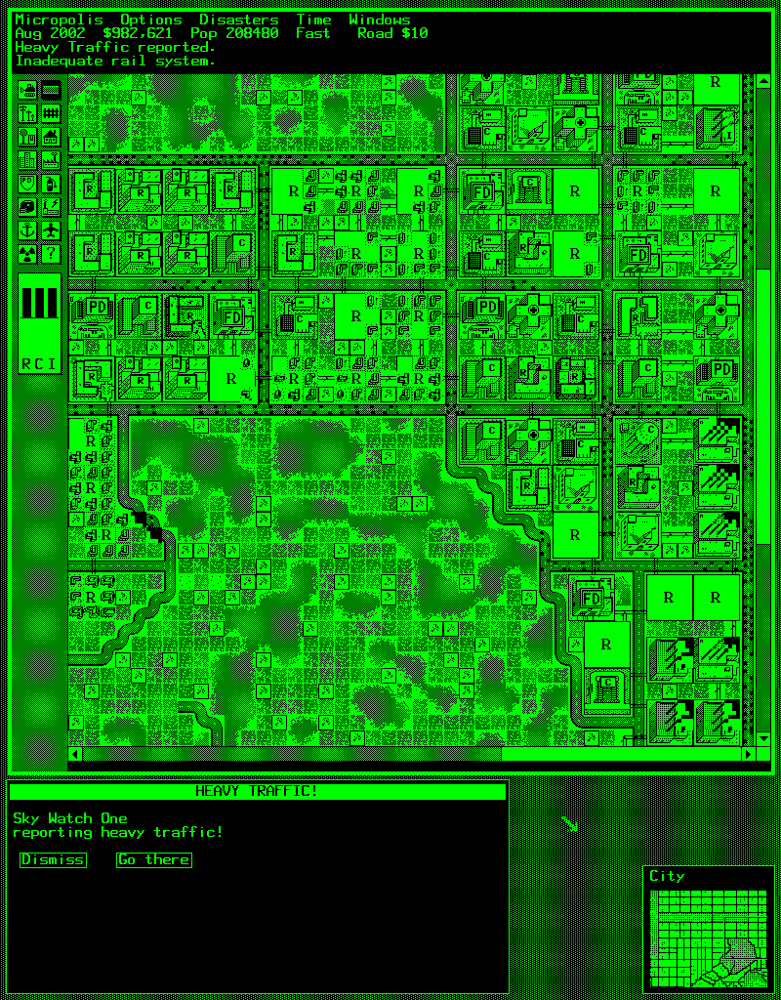

# Micropolis for the AT&T DMD 5620

Micropolis, the open source city simulator, for the AT&T / Teletype
DMD 5620 terminal (the Blit) on an AT&T 3B2 with UNIX System V 3.2.
The simulation runs on the 3B2. The DMD 5620 draws the city in
`layers` windows: the editor, a small map, budget, evaluation, graph
and notices.

This is a modified version of Micropolis; it is not the original
program.



## Install

Get `mcity3b2.tar` from the
[releases](https://github.com/tenox7/dmdcity/releases) and copy it to
the 3B2. (`mcity3b2.tgz` is the same file, compressed: gunzip it
first.) Then, as root:

```
cd /
tar xf /path/to/mcity3b2.tar
chmod 777 /usr/dmd/lib/mcity/cities     # lets every user save cities
```

It puts the game in `/usr/dmd/bin/mcity`, and its files in
`/usr/dmd/lib/mcity`: the 3 DMD programs (`mcity.m`, `mcmap.m`,
`mcform.m`), the tile art (`tilesbw.dat`), `res` (scenarios and texts)
and `cities`.

You need:

- A 3B2 with UNIX System V 3.2, a WE32100 CPU and the WE32106 math
  chip (MAU). The gcc runtime on the build system uses the MAU.
- The DMD 5620 software in `/usr/dmd` (`layers`, `32ld`, `libwindows`).
- `/shlib/libnsl_s` (Networking Support Utilities).
- A DMD 5620, or the [dmd5620](https://github.com/tenox7/dmd5620)
  emulator, in `layers`, at 19200 baud.

Tested on the SIMH 3B2/400 with SVR3.2 and the dmd5620 emulator. The
ready to run SIMH kit
[att3b2-400-svr32-simh.tar.lz](https://files.42718.net/mirror/tenox/os/att/3b2/att3b2-400-svr32-simh.tar.lz)
has all of the above, and Micropolis is installed in it. Not tested yet
on a real 3B2 or a real DMD 5620.

## Run

1. Reshape a layer to the top 3/4 of the screen: from the top left
   corner to about x 796, y 794. The game opens its other windows in
   the space below it: notices bottom left, the map bottom right.
2. In that layer:
   ```
   /usr/dmd/bin/mcity /usr/dmd/lib/mcity/cities/haight.cty
   ```
   Without a city file it makes a new city. If the DMD software is not
   in `/usr/dmd`, set `DMD` to its folder first.
3. The 3 DMD programs load in about 1 minute at 19200 baud. The city
   shows at once. The tile art comes after it: until then, each tile
   shows as a 4x4 picture.

## Use

- Button 1: the menu bar, a tool in the palette, the tool on the map.
  Button 2: the tools menu. The status line shows the tool and its cost.
- Menu bar:
  - Micropolis: about, new city (easy, medium, hard), load city,
    scenario, save city, save as, quit
  - Options: auto budget, auto bulldoze, disasters, animation,
    messages, notices, auto goto, palette, invert
  - Disasters: monster, fire, flood, meltdown, tornado, earthquake
  - Time: pause, slow, medium, fast
  - Windows: map, graph, budget, evaluation, notice, redraw
- Scroll: the scroll bars (arrow: 2 tiles, hold to repeat; grey: a
  page; drag the white thumb), the arrow keys or `h j k l` (`H J K L`
  more), or button 1 on the small map.
- Keys in the main window: `m` map, `g` graph, `b` budget,
  `e` evaluation, space pause, `i` invert, `q` quit (it asks first).
- Small map: button 1 moves the editor there. Button 2 or 3: the map
  kind (city, residential, commercial, industrial, power grid,
  transport, population, growth, traffic, pollution, crime, land
  value, fire cover, police cover).
- Form windows (budget, evaluation, ...): button 1 on a button.
  Button 3: close.
- Windows: move, reshape, top and delete them with the `layers` menu
  (button 3 on the background or a border). They draw again at the
  new size.
- Budget: when the year ends (auto budget off), the game pauses until
  you click Continue.

## How it works

The DMD 5620 is a terminal with its own CPU (a WE32000), its own
memory and an 800x1024 1 bit screen. `layers` puts
several windows on it. Each window has its own program and its own
channel to the host (xt). The line to the host is slow: about 450
bytes a second at 19200 baud on the SIMH 3B2. So the work is split:
the host does all of the simulation, the terminal does all of the
drawing and everything else that needs no simulation. Only small
changes go over the line.

```
 3B2 (host)                                DMD 5620 (terminal)
+----------------------------+   xt 1   +--------------------------------+
| /usr/dmd/bin/mcity         |<-------->| mcity.m   the editor (your     |
|   simulation engine        |          |           layer): map, tiles,  |
|   tools, money, files      |   xt 2   |           menus, palette       |
|   draws the small map      |<-------->| mcmap.m   the small map        |
|   lays out the forms       |   xt 3+  | mcform.m  budget, evaluation,  |
|   makes the layers (agent) |<-------->|           graph, notice, files |
+----------------------------+          +--------------------------------+
```

### On the 3B2: `mcity` (host/)

- The Micropolis engine (`s_*.c`), as in the original: zones grow and
  decay, traffic, the power grid, pollution, crime, land value, fire
  and police cover, population, disasters, the yearly budget, the
  evaluation and the graph history. The host loop runs 10 times a
  second; the simulation takes 20 to 40 ms of the 3B2's CPU in each.
- The tools (`w_tool.c`): what each tool may build, its cost, the
  bulldozer, and roads, rails and wires that connect by themselves.
- Load and save cities, the 8 scenarios, new maps.
- Messages and notices. The texts come from `res/micropolis.tcl`.
- The contents of the budget, evaluation, graph, notice and file
  windows. The host lays them out as display lists (text, buttons,
  bars, graphs, input fields).
- The small map. The host draws it, 1 bit a cell (120x100 = 1500
  bytes), in the kind the window asks for. It sends only the rows that
  changed, PackBits compressed. Roads and water are ink, parks are
  light dots, the rest is ground.
- What to send next, most important first: status, the cells of the
  view, the palette icons, the art of the tiles in the view, changes
  in the view, changes elsewhere, the rest of the art.
- The windows: the host makes the other layers with the `layers`
  agent (`libwindows`), and loads a DMD program into each one with
  `32ld`, as its child.

### On the DMD 5620: 3 programs (term/)

- `mcity.m`, the editor, in your layer:
  - Keeps a copy of the whole map (120x100 cells, 24 KB) and the art
    of all 960 tiles (16x16, 30 KB).
  - Draws the view from that copy. Scrolling needs nothing from the
    host when the cells are there already.
  - Animates the tiles by itself (traffic, fire, smoke, radar, ...)
    from a table of next frames (`anitab.h`), and blinks the bolt on
    zones without power.
  - Has the menu bar, the menus, the tool palette, the R C I demand
    bars, the status lines, the scroll bars and the earthquake shake.
  - Sends the host only the view (x, y, w, h), tool clicks and drags,
    and menu items.
- `mcmap.m`, the small map: shows the rows the host draws. The 5620
  has no MMU, so it reads the editor's view straight from `mcity.m`'s
  memory (`share.h`) and draws the view frame by itself. A click there
  asks `mcity.m` (in that shared memory) to look at that place.
- `mcform.m`, one per form window: draws the host's display list, and
  draws it again after a reshape without the host. It sends button
  clicks, menu items and typed text.

### On the line

- Start: the 3 programs load (`mcity.m` 51 KB, `mcmap.m` 32 KB,
  `mcform.m` 10 KB) in about 30, 16 and 11 seconds.
- The city: 12000 cells, run-length coded. A whole small map is
  about 1.6 KB.
- In play: only the cells that changed (2 bytes each), the status
  text, the demand and the small map rows that changed.
- Flow: the terminal sends `a` for every 64 bytes it read. The host
  keeps at most 128 bytes in flight per window. Without this, the
  SVR3.2 xt driver stopped after about 130 bytes.

The headers of `host/dm_host.c`, `term/mcity.c`, `term/mcmap.c` and
`term/mcform.c` list every command of the protocol.

## Build

On the 3B2, with gcc 2.7.2.3 and the DMD software:

```
cd host; make                  # mcity, with gcc
cd ../term
DMD=/usr/dmd; PATH=$PATH:$DMD/bin; export DMD PATH
make                           # mcity.m, mcmap.m, mcform.m, with dmdcc
cd ../host; make install       # as root
```

The DMD programs are K&R C for `dmdcc`. The host is K&R C too, like
the engine. `MCHOME` sets the data folder (default
`/usr/dmd/lib/mcity`), `MCLOG` a log file.

Tools (Python 3, on any computer):

- `tools/mkicons.py`: the 16x16 tool icons, drawn for this port.
  Writes `term/palette.h` and `host/icons.h`.
- `tools/mkdat.py`: `data/tilesbw.dat` from `images/tilesbw.xpm` of
  the Micropolis GPL release.
- `tools/mktiles.py`: `term/anitab.h` from `animtab.h`.
- `tools/macbuild.sh` and `tools/fakedmd.py`: build the host on a Mac
  and run it against a fake terminal, to test the host alone.

## Findings

- `layers` on SVR3.2: without the `a` acks above, 2 packets were
  never ACKed, and the xt driver did not send them again.
- `TCSETAW` on an xt channel with old output can sleep forever. Use
  `TCFLSH`, then `TCSETA`. `close()` also waits for the output to
  drain: flush first.
- The agent can't delete the current layer. Make the host's own layer
  current first (its channel: `minor(st_rdev) & 7` of `fstat(0)`).
- About 6 layers in practice. When a new layer fails, the host reuses
  a form window's layer, or puts notices on the message line.
- While the `layers` menu waits for a sweep, the whole xt link stops.
- Names of DMD ROM calls are macros in `dmd.h` (`outline`, `Rect`,
  `sw`, `min`, `max`, `string`, ...). A function with the same name
  gives "syntax error". Check with `dmdcc -E`.
- Static arrays, even all-zero ones, go to .data and down the line
  with the program. Big tables are not static and have no values, so
  they are in bss.
- The DMD's `sprintf` has no `%03d` and no `%ld`.
- At 1 pixel a cell, a 25% pattern on a 1 pixel road disappears on
  odd rows. Lines use only full ink or 50% grey. XOR lines disappear
  on 50% grey, so the view frame is drawn solid.

## Limits

- No sprites yet (trains, planes, helicopters, the monster).
- The speed of the line is the main limit.

## Credits and legal

- The engine comes from
  [Micropolis for SunView](https://github.com/tenox7/micropolis-sunview),
  which comes from
  [Micropolis Legacy](https://github.com/tenox7/micropolis-legacy).
- The tiles, cities, scenarios and texts are from the Micropolis GPL
  release by Electronic Arts (micropolis-activity).
- The tool icons are new drawings for this port.
- License: GNU GPL v3 with the additional terms from Electronic Arts,
  see [LICENSE](LICENSE) and [COPYING](COPYING).
- Micropolis, Unix Version. Copyright (C) 1989 - 2007 Electronic Arts
  Inc.
- No trademark rights are granted. This project has no affiliation or
  association with Electronic Arts Inc.
